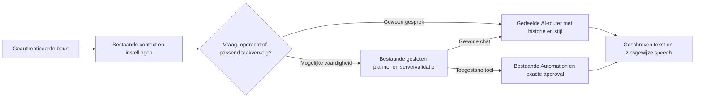

# JARVIS experience overhaul — resultaat en grenzen

25 november 2026. Eerste incrementele ervaringsverbetering binnen fase 7.5.
De gebruikersvisie staat onverkort in JARVIS_MASTER_VISION.md. Dit rapport
claimt geen definitieve menselijke acceptatie of voltooiing van de roadmap.

## 1. Waarom het onnatuurlijk aanvoelde

Domeinwoorden konden een verhaal naar de toolplanner sturen. Open taakvragen
konden een nieuw onderwerp onderscheppen. Een planner die gewone chat koos,
leidde tot een vaste functie-uitleg of een apart antwoord zonder historie/stijl.
Het kleine lokale model kreeg daarnaast soms meer input dan zijn werkelijke
runtimecontext toeliet. De review onderscheidt dit codebewijs van modelkwaliteit.

## 2. Architectuurproblemen

De benodigde centrale managers bestonden al; het probleem zat vooral in de
overgangen. Er is geen tweede engine/database/framework toegevoegd. Zie de
componentenkaart en gap analysis in ARCHITECTURE_REVIEW.md. Een extra bevinding
uit de 50-beurtregressie: extractieve notities behielden alleen een verschuivende
staart, waardoor het begin van het gesprek vroegtijdig verdween.

## 3. Tegenstrijdige instructies

De basisprompt ontkende alle agenda-/mail-/actievaardigheden terwijl de backend
ze wel heeft. Die ontkenning is vervangen door correcte servergrenzen: het model
verleent geen rechten en mag uitvoering alleen met backendbewijs bevestigen.
Het universele 'geef eerst het directe antwoord' maakt nu ruimte voor verhalen,
grappen en gedachten. De bestaande voiceprompt blijft kanaalgebonden.

## 4. Verbeterde componenten

ChatService beslist één keer over de route. AutomationChat gebruikt een lichte
vraag-/opdrachthint naast de bestaande gesloten validatie, behoudt natuurlijke
leesverzoeken zonder vast commando en laat gewone verhalen vaker direct door.
Een oude leesvraag bindt alleen aan het laatst daadwerkelijk getoonde antwoord.
Gewone eerste-persoonsverhalen worden niet als vrije schrijftitel ingevuld.
Dit is begrensde Nederlandse heuristiek, geen universeel intentbegrip.

ContextManager levert persoonlijkheidswaarden aan tekst én spraak en bewaart
beginonderwerpen plus recente bronnotities binnen maximaal 5000 tekens. Bij
weglaten wordt dat vermeld; het bewaarbeleid van maximaal 100 bronbeurten en het
actuele contextbudget blijven gelden. Er wordt geen volledig episodisch geheugen
of onbeperkt contextbehoud geclaimd.

## 5. Verwijderde overbodige verwerking

Geen dubbele kandidaatselectie voor voice. Verhalen met domeinwoorden hebben
in de nieuwe contract-/modelproeven geen plannercall. Bij chat-terugval is de
aparte persoonlijkheidsloze antwoordprompt/verzamelbuffer vervangen door gewone
routerstreaming. Als een planner nodig was, blijft die beslissing wel één extra
modelcall kosten. Er is geen classificatiemodel aan iedere beurt toegevoegd.

## 6. Nieuwe gespreksroute

De chat-terugval krijgt expliciet mee dat deze beurt geen nieuwe persoonlijke
gegevens heeft opgehaald of actie uitgevoerd. Ook die instructie valt binnen
hetzelfde contextbudget. Eerder bevestigde broninformatie blijft beschikbaar.

## 7. Qwen2.5:3B

Het lokale model is behouden; de verouderde repository-/voorbeelddefault 0.6B
is gelijkgetrokken naar Qwen2.5:3B. Bestaande expliciete .env-/gebruikersoverrides
zijn niet gewijzigd. Geen download, groter model of modelinstallatie.

De echte eerste meting rapporteerde via `/api/ps` 4096 runtimecontexttokens.
De server kon 6000 inputtokens plus output aanbieden. De headless Ollama-provider
kiest daarom nu expliciet native `/api/chat` binnen de bestaande gedeelde
`OpenAICompatLLM`, met `options.num_ctx` voor input + output + rolreserve, afgerond
op 1024. Het standaardprofiel reserveert 8192 tokens. De optie is uitsluitend
headless opt-in; upstream desktopgedrag blijft hetzelfde. NDJSON-terminalen,
malformed frames, rollen, verborgen thinking, outputgrens en annulering worden
onder het bestaande fout-/deadlinecontract verwerkt.

## 8. Gemini

Gemini behoudt hetzelfde gedeelde chattransport en dezelfde toegestane context,
persoonlijkheid, requestpolicy en fallbackgrens. Providerwisseling is met mocks
getest. In deze opdracht is geen echte Gemini-aanvraag of betaalde dienst
geactiveerd. Dat bewijst dus geen huidige Gemini-beschikbaarheid of taalniveau.

## 9. Context

De echte 20/50-beurtproeven bevatten onderwerpwissels en een terugvraag naar een
fictief schilderproject aan het begin. De laatste 30 beurten van de lange proef
zijn bewust herhalende gedachten over kleur/muziek: een herhalingsstresstest,
geen representatieve volledige natuurlijke dialoog. In de eerste 4096-tokenrun
stond het beginonderwerp wel in de servercontext maar miste Qwen de terugvraag.
Na de contextallocatiecorrectie beantwoordde Qwen die wel met naam en kleuren.
Dit is een gecontroleerde waarneming in één run per variant, geen statistisch
bewijs dat alle toekomstige verwijzingen goed gaan.

## 10. Persoonlijkheid en modelkwaliteit

Alle profielwaarden bereiken beide kanalen en chat-terugval; aanspreekvorm blijft
instelbaar. De echte modelantwoorden zijn **nog onvoldoende voor eindacceptatie**:
Qwen zegt soms 'mijn schilderproject' waar 'uw schilderproject' hoort, stelt
overbodige vragen, gebruikt wisselend je/u en produceert onnatuurlijke zinnen.
Het model is niet vervangen en er zijn geen hardcoded scenarioantwoorden gemaakt.

De 50-beurtstresstest had voor de allocatiecorrectie 27 exacte dubbele antwoorden;
erna 0. Ook na de correctie zijn er inhoudelijke herhaling en stijlproblemen.
Het aantal antwoorden dat op '?' eindigt (5/50 na correctie) is geen betrouwbare
telling van alle onnodige vragen: vragen kunnen midden in een antwoord staan.
De twintigbeurtproef onthield het project in beide varianten.

## 11. Uitgevoerde technische tests

- Eerst 14 nieuwe API-contractcontroles: **11 faalden, 3 slaagden** op de begincode.
- Gerichte finale provider-/ervaring-/mailcontroles: **67 geslaagd**.
- Volledige lokale serverregressie: **465 geslaagd**, 184,00 s. Dit omvat de
  tien al aanwezige, ongestagede mailtests van de gebruiker; die zijn geen deel
  van deze commit/PR. De gepubliceerde tree heeft daarom een ander testtotaal.
- Windows-client: **114 geslaagd**, 8,59 s, offscreen zonder microfoon/accounttest.
- Ruff, mypy (30 server/shared-bestanden), Android-settingscontract, server pip
  check, repositorycontrole en whitespacecontrole geslaagd.
- Geen nieuwe Android-clientcode/APK of Windows-build nodig voor deze backendroute.
  Native hardware-/installatieacceptatie is niet opnieuw uitgevoerd.

| Scenario | Werkelijk bewijs | Open |
|---|---|---|
| A informeel | Echte lokale 20 beurten, geen planner/jobs; API-regressies | Menselijke natuurlijkheid |
| B praten → taak | API: gesprek → synthetische agenda-read → gesprek; bestaande schrijf-/approvaltests | Algemene vrije verwijzingen zoals 'vraag maar of dat kan' |
| C onderwerpen | Nieuwe domeinverhalen/taakvraagwissels plus bestaande contexttests | Subjectieve samenhang |
| D onderbreken | Bestaande cancel/epoch/approvalregressies; echte private helperannulering en verse aanvraag | Hoorbare stop, focus, echte microfoon/echo |
| E offline | Echte Qwen 20/50, 42 lokale TTS-zinnen, STT-proef en echte lokale spraakketen | Gehele fysieke dialoog/luisterkwaliteit |
| F proactief | Bestaande synthetische notificatie-/quiet-hours-/opvolgingstests | Volledige melding → natuurlijke vervolgcontext |
| G modelwissel | 20/50-beurt API-test met Ollama → Gemini-mocks en bestaande privacyfilters | Echte Gemini en open taakovergang |
| H lang | Echte 50-beurtstresstest; beginonderwerp na correctie teruggevonden | Gevarieerde menselijke dialoog en langetermijnrelevantie |

## 12. Prestaties

Gemeten op de ontwikkeldesktop, met synthetische tekst, afzonderlijke tijdelijke
accounts/databases en bestaande modellen. Sommige lokale tests/TTS-metingen liepen
tegelijk; dit is geen geïsoleerde hardwarebenchmark of mini-pc-meting.

| Meting | Resultaat / betekenis |
|---|---|
| AI eerste token, native 20 beurten | mediaan **0,542 s**, serverklok |
| HTTP totaaltijd, native 20 beurten | mediaan **1,352 s**; eerste gemeten run 4,635 s, geen zuivere koude-startmeting |
| AI eerste token, native 50 beurten | mediaan **1,283 s**, serverklok |
| HTTP totaaltijd, native 50 beurten | mediaan **2,085 s** |
| STT, aparte drie-WAV-proef | mediaan **1,556 s**, CPU-fallback; eerste 3,407 s |
| TTS 42 zinnen/varianten | warm mediaan **1,398 s Supertonic**, **0,221 s Piper**; eerste Supertonic 3,026 s |
| TTS-helperpiek | **518,1 MiB** in de 42-zinsproef |
| Server/harness-RAM | circa **74–80 MiB** snapshots; exclusief Ollama/helper |
| GPU | native snapshots **95–96%**, **6561–6567 MiB** systeemwijd; geen exclusieve JARVIS-meting |
| CPU | harness circa **28,6% van één kern** over gemeten interval; TTS kan meerdere kernen gebruiken; geen systeemgemiddelde |
| Gecombineerde synthetische spraakketen | einde aangeboden PCM → eerste antwoordzin-PCM **3,488 s Piper**, **2,865 s Supertonic**; twee verschillende koude/warme samples, geen snelheidsrangorde |
| Ketenonderdelen | STT **2,302/1,311 s**, AI eerste token **0,855/0,328 s**, eerste-zin-TTS **0,059/1,107 s** voor Piper/Supertonic |
| Private helperrequest annuleren | **40,5 ms** tot requestthread gestopt; verse aanvraag daarna geslaagd; geen hoorbare-stopmeting |

De spraakketen gebruikt de bestaande helper en echte ChatService-events, maar
speelt niets af. Tijd tot hoorbaar geluid en fysieke interruptielatency zijn
**niet gemeten**. Een privé-inferencerequest is echt geannuleerd terwijl de
workerthread nog liep; daarna leverde een verse aanvraag geldig WAV. De exacte
requestannulering staat in het lokale audio-chain-rapport; die is geen AEC- of
hoorbare stopmeting.

Scripts: `scripts/benchmark_conversation.py --run-local`,
`scripts/benchmark_tts.py --output .local/experience-benchmark/tts`,
`scripts/benchmark-voice.py --turns 3 --output .local/experience-benchmark/voice.json`
en `scripts/benchmark_audio_chain.py`. Voer ze met de bestaande ontwikkelvenv
en geïnstalleerde private voice-runtime uit; geen modellen worden gedownload.
Ruwe synthetische rapporten/WAV blijven onder `.local/experience-benchmark/`,
buiten Git. De HTTP-testclient buffert SSE; gebruik de server-timing voor eerste
token, niet het tijdstip waarop deze HTTP-client zijn eerste regel teruggeeft.

## 13. Beperkingen

Geen algemene conversation-native toolcalling, universele referentresolver,
semantisch episodisch geheugen, betrouwbare reistijdbron of nieuwe integraties.
Geen Edge/XTTS-installatie: online gedrag/zwaardere runtime is hier niet nodig.
Supertonic/Piper zijn opnieuw gemeten, geen definitieve stem gekozen. Qwen blijft
aantoonbaar beperkt in Nederlands en gesprekstijl. Ook 8192 context garandeert
geen goed begrip of geschikt geheugenverbruik op de onbekende 8-GB-mini-pc.

## 14. Handmatige acceptatie

Voer A–H uit volgens CONVERSATION_ACCEPTANCE_TESTS.md. Vooral: echt twintig
beurten vrij praten, titel/datumcorrectie na onderbreking, onderwerpwissel tijdens
een taakvraag, Windows-vensterwissel, Stop, denktijd en eigen-spraak-echo, offline
spraak en Voice Studio-luistervergelijking met de bestaande favoriete stem.
Noteer concrete mislukte beurten en beoordeel natuurlijkheid en stijl apart van
technische correctheid. Een nieuwe microfoon-/accountgrant is hiervoor geen
automatische stap.

## 15. Vervolg en fasegrens

Eerst de resterende gesprek-/taakreferenties en echte spraakacceptatie. Daarna
relevantie van geheugen, planning en proactiviteit volgens de prioriteiten in
EXPERIENCE_IMPROVEMENT_PLAN.md. Voor modelvergelijking kan dezelfde set later
op de al ingestelde Gemini-route worden uitgevoerd wanneer de gebruiker daar
een passende gratis/geautoriseerde configuratie voor heeft; geen automatische
modelvervanging of nieuwe download. Fase 8, oproepen, nieuwe communicatieplatforms,
permanente service, publieke toegang en servermigratie zijn niet uitgevoerd.
