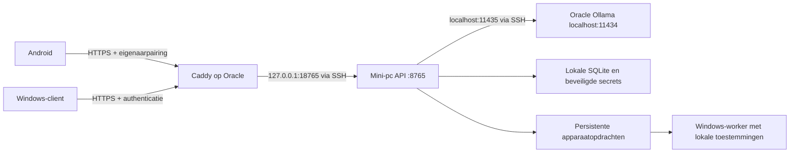

# Hybride JARVIS

De mini-pc bewaart accounts, machtigingen, SQLite-geheugen, pending actions,
agenda-/mailkoppelingen, automatiseringen en de API op loopback:8765.
Eenvoudige Nederlandse opdrachten, bevestigingen en openbare reads gebruiken
Python. Een zwaar taalmodel op de mini-pc is niet nodig.

Oracle draait uitsluitend Ollama-inference en de Caddy HTTPS-gateway.
Een vanuit huis gestarte SSH-link verbindt twee vaste loopbackpoorten:

De gateway overschrijft forwarded headers, begrenst bodies, verbergt interne
controleroutes en gebruikt een gevalideerd certificaat. SSH-hostsleutels zijn
vooraf gepind. De linkgebruiker heeft geen shell en kan geen andere poorten
openen. Er wordt geen database of private SSH-sleutel naar Oracle gestuurd.
Een gratis sslip.io-hostnaam vermijdt een betaald domein en een telefoon-VPN.
Dit is een afhankelijkheid van publieke DNS/ACME, geen beschikbaarheidsgarantie.

## Gesprekken en precies één uitvoering

Bestaande Automation/ApprovalManager, payloadfingerprints, request-ID's en
SQLite-pending actions blijven gezaghebbend. Eén ja start de executor direct;
spraak bevestigt pas een ontvangen API-resultaat. Gewijzigde of verlopen
voorstellen worden gesloten. Een expliciete nieuwe leesopdracht verwijdert de
oude chatbinding; een losse ja zoekt nooit automatisch een ander voorstel op.
Eigenaarrechten, hoogrisicogoedkeuringen en sessie-/apparaatbinding blijven gelden.

## Apparaatopdrachten

De bestaande eigenaarpairing registreert apparaten. Windows ontvangt alleen na
expliciete opt-in, met een lijst toegestane programma's/documentmappen en de
bestaande scopes. De dispatcher gebruikt het eigen Windows-apparaat, een gekozen
standaardcomputer of precies één beschikbare computer. Anders wordt niets gekozen.
Android behoudt de bestaande korte, geauthenticeerde apphandoffs en OS-beperkingen.

Een opdracht heeft één job-ID, bron/eigenaar/doel, een termijn van hoogstens twee
minuten en een eenmalige leasestart. Leasegeheimen worden serverzijdig uitsluitend
als digest bewaard. Een niet gestarte lease kan opnieuw worden aangeboden. Een
verlopen gestarte lease krijgt `uncertain`, zonder opnieuw uitvoeren. De Windows-
worker schrijft voor uitvoering een receipt en hergebruikt de gesloten hostadapter;
geen modelcode, shellcommando of Qt-widget wordt op een uitvoerthread gestart.
Resultaten wijzigen dezelfde oorspronkelijke taak en worden niet als voltooid
gepresenteerd zolang slechts een queue-item is gepubliceerd.

## Configuratie en uitval

AI-instellingen bieden local/hybrid/cloud, Oracle-model, compacte context,
streaming, offline beleid en bestaande provider-/kostenkeuzes. Stockinstructies
worden voor Oracle compact doorgegeven; expliciete eigen systeeminstructies
blijven volledig behouden. HTTP-verbindingen worden hergebruikt. Openbare bronnen
hebben afzonderlijke cachelocks, zodat verschillende bronnen parallel laden en
dezelfde bron maar eenmaal wordt opgehaald.

Bij ontbrekende Oracle/tunnel/modelconfiguratie blijven lokale functies en
directe integraties werken. Zonder internet zijn actuele weer-, agenda- en
mailresultaten niet geverifieerd; fouten worden niet als succes voorgesteld.
Optionele lokale Ollama-fallback vereist een bestaande bewuste installatie;
het pakket downloadt geen lokaal taalmodel.

## Installatie en grenzen

`python scripts/build_minipc.py` maakt de zelfstandige distributie en ZIP.
De geïsoleerde server- en spraakvenvs delen geen desktopstack. Whisper Small/Piper
zijn optionele, expliciete installerdependencies; bestanden en versleutelde data
staan buiten versie-releases. SYSTEM-opstarttaken herstarten na een crash.
Beveiligde machine-DPAPI maakt een service zonder aangemelde gebruiker mogelijk.
Herstel bewaart oude data, trekt herstelde sessies/approvals in en pauzeert open
taken zodat oude externe acties niet opnieuw worden uitgevoerd.

De mini-pc is nog niet beschikbaar. Geïsoleerde desktoptests bewijzen geen echte
SYSTEM-opstart/herstart, mini-pc-prestaties of aangesloten accounts/hardware.
Home Assistant, route-API, oproepen en productiepush blijven afhankelijk van
uw echte beschikbare diensten en expliciete grants. Phone Link/Creality Cloud
worden niet voorgesteld als algemene bedienings-API zonder ondersteunde koppeling.
Zie de [installatiehandleiding](../deploy/minipc/INSTALLATIE.md) en
[werkelijke metingen](HYBRID_BENCHMARKS.md).
