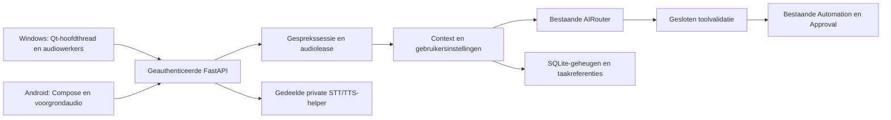

# Natural Conversation Engine — architectuur

Fase 7.5 breidt de bestaande server op localhost:8765 uit. De bestaande headless
AIRouter, ChatService, private speechhelper, AutomationEngine, ApprovalManager,
authenticatie en native clients blijven in gebruik. Upstream Qt/Live-code wordt
niet in de server geïmporteerd. Er is geen tweede backend of gebruikersdatabase.

## Verantwoordelijkheden

- NaturalConversationManager: 14 toestanden, epoch, lease, heartbeat, timeouts,
  expliciete apparaatsovername en herstel naar RECONNECTING na herstart.
- ContextManager: begrensde relevante context, lokale samenvattingen,
  bronbewust vergeten en RAM-context bij uitgeschakelde geschiedenis.
- MemoryManager: gebruikersisolatie, FTS5, revisies, gevoelige toestemming,
  correcties, expiry en CRUD; geen autorisatie vanuit geheugeninhoud.
- SettingsManager: strikt gevalideerde globale/apparaatinstellingen in SQLite,
  revisies, CAS, import/export/reset en audit zonder instellingenwaarden.
- Intent-/slotlaag: letterlijke gebruikersdelen, Nederlandse tijden,
  afhankelijke opdrachten en servervalidatie vóór bestaande tooluitvoering.
- Diagnostics/Retention: begrensde numerieke metingen en lichte lokale opruiming.

Windows bewaart widgets op de hoofdthread en netwerk/audio op workers. Android
gebruikt Coroutines en stopt audio bij verlaten van de app/focusverlies. Beide
clients houden apparaatkeuze en OS-toestemming apart van gedeelde voorkeuren.
Een instelling opent geen microfoon bij opstart. Eén bewuste activatie kan wel
een ingestelde voorgrondgesprekslus starten.

## Transport en veiligheid

De huidige keten gebruikt begrensde WAV-aanvragen voor STT/TTS en SSE voor AI-tekst.
Complete zinnen kunnen worden uitgesproken vóór het hele antwoord klaar is.
De audiolease bindt voice-chat aan apparaat/authsessie/epoch. Een overname stopt
oude audio/generatie; duurzame externe taken worden niet blind geannuleerd.
Alle externe mutaties behouden hun afzonderlijke exacte approval.

Audiointerfaces blijven los van de gesprekscontext, zodat een toekomstige
WebSocket-/WebRTC-adapter dezelfde managers kan gebruiken. In deze fase is geen
telefonie, WebRTC-server, publieke deployment of mini-pc-migratie toegevoegd.
Voor de concrete protocol-/hardwaregrenzen: VOICE_STREAMING.md.

## Verificatie

Automatische tests gebruiken synthetische accounts, tijdelijke databases, echte
TCP, private helperproeven en een afzonderlijke Android-AVD. Echte STT/TTS is
met synthetische WAV-data getest. Dit vervangt geen menselijke microfoon-/echo-
acceptatie. Fase 7.5 blijft in uitvoering totdat de beschreven criteria en
resterende runtime-instellingen/hardwareproeven zijn afgehandeld.
