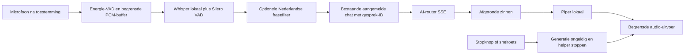

# Nederlandse spraak in de Windows-app

Fase 5 breidt dezelfde PySide6-app uit. Er is één QApplication en één bestaande
FastAPI-server op 127.0.0.1:8765. De voicehelper is uitsluitend een lokaal
inferenceproces met private stdin/stdout-pipes, zonder venster of netwerklistener.
De server start nooit vanuit de client. Android en mini-pc-deployment vallen buiten deze fase.

`jarvis_client/voice/` bevat AudioInputManager, AudioOutputManager,
AudioDeviceManager, VoiceActivityDetector, WakeWordEngine,
VoiceConversationManager, InterruptionController en VoiceSettingsManager.
`voice_runtime/engines.py` bevat SpeechToTextProvider en TextToSpeechProvider.
Qt-widgets staan alleen in `panel.py` op de hoofdthread. Capture, inference en
playback draaien op workers; Qt-signalen leveren resultaten terug.

Capture: mono PCM16, 16 kHz, blokken van 30 ms, maximaal 120 seconden (standaard
60). Een energiepoort reageert na minimaal 210 ms spraak en instelbare stilte.
Een tweede Silero-pass in faster-whisper beperkt lege/noisetranscripties.
Dit is geen garantie tegen tv/andermans spraak: herkenningsfouten blijven mogelijk.
Whisper verwerkt de hele uiting; gedeeltelijke live STT wordt niet geclaimd.
Een halve seconde nulcontext aan de randen beschermt korte ASR-uitingen.

Alleen herkende tekst gaat naar dezelfde `send_message`/ApiClient-stream en
dezelfde conversation_id. Auth, Credential Manager, TLS, scopes, tokenrotatie,
SSE-annulering en geschiedenis blijven ongewijzigd. Geen audio-endpoints of AI-acties.
Het providerkeuzemenu op Chat geldt ook voor spraak.

SSE-delta's vormen afgeronde zinnen of een segment van maximaal circa 400 tekens
op een woordgrens. Maximaal 32 wachtende segmenten; bij overschrijding stopt
spraak met melding, tekststream blijft beschikbaar. Eén Piper-stem geldt voor het
hele antwoord. Synthese en afspelen verlopen serieel om geheugen te begrenzen;
er kan daardoor een kleine pauze tussen zinnen ontstaan. Geen onbewezen hybride winst.
Een optionele LRU-cache houdt maximaal 8 MB WAV-data uitsluitend in RAM.

Stop: PortAudio abort, generatie ophogen, capture annuleren, tekstqueue vervangen,
eigen inferenceprocesboom stoppen en bestaand AI-cancelverzoek versturen.
Late resultaten/generaties worden geweigerd. Een nieuwe PTT-opdracht kan starten;
als de oude AI-stream nog afsluit, wacht alleen het nieuwe transcript totdat die
afsluiting bevestigd is. Geen automatische herverzending bij een netwerkfout.
Shutdown wacht ook op capture/playback en de eigen procesopruiming.

Halfduplex voorkomt eigen-stemfeedback: geen opname tijdens antwoorden/afspelen,
450 ms uitloop vóór optionele vervolgopname. Een headset helpt bij driverbuffers.
Spraakgestuurde barge-in/AEC is niet geïmplementeerd; knop en sneltoets werken wel.

Wake word is een **experimentele frasefilter na Whisper**, niet openWakeWord met
een Nederlands getraind model. Alleen een uiting die begint met Hé/He/Hey/Hee
en Jarvis (beperkte spellingvariant Jervis) activeert. Andere standbyteksten gaan
niet naar de server. Een losse activatie opent de volgende opname; zonder spraak
volgt timeout. Default uit, expliciete onthoudbare toestemming en zichtbare microfoonstatus.
De eigenaar vroeg om de microfoontoestemming en gekozen apparaten blijvend te
bewaren. Na sessieherstel is die toestemming weer beschikbaar, maar de app opent
bij opstart nog geen microfoon. Live energieniveau en de statussen Ik luister /
Ik hoor je / Spraak verwerken / JARVIS denkt / JARVIS spreekt maken de fasen
zichtbaar. Definitief verstaan blijkt uit het transcript, niet uit alleen de VAD.
Betrouwbaarheid in echte kamers moet handmatig worden getest; geen always-on-claim.

Profielen: desktop kan beide engines vasthouden in de helper; expliciet stoppen
en nieuwe opnames annuleren de oude helper om overlap te voorkomen. Light maakt de andere engine vrij vóór
inference, CPU int8 kan apart worden gekozen. Tiny/Base zijn selecteerbaar maar
worden niet automatisch gedownload. CUDA vereist passende cuBLAS12/cuDNN9;
ontbrekende DLL's of inferentiefouten geven CPU-fallback. Geen CUDA-installatie of
permanente PATH-wijziging. De toekomstige 8-GB-mini-pc is hiermee voorbereid,
niet getest of ingericht.
